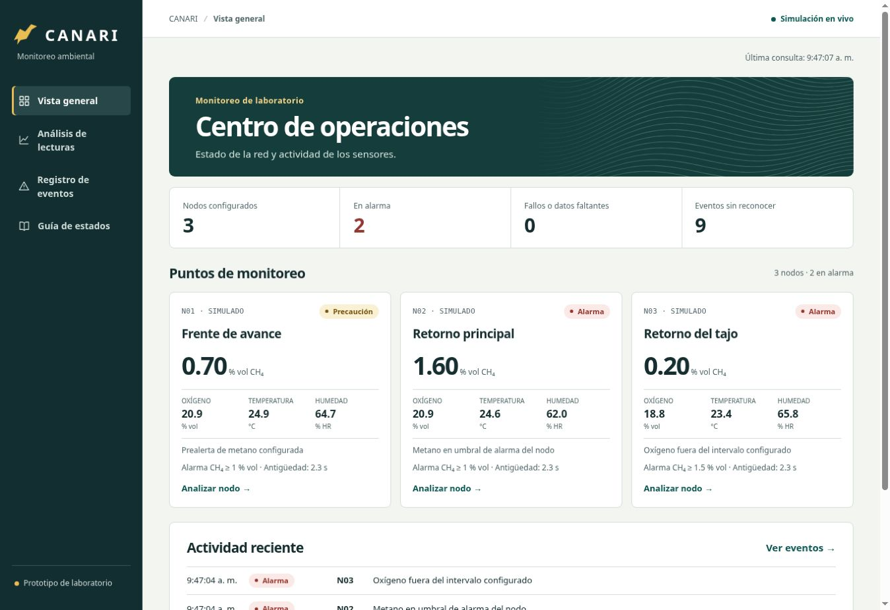
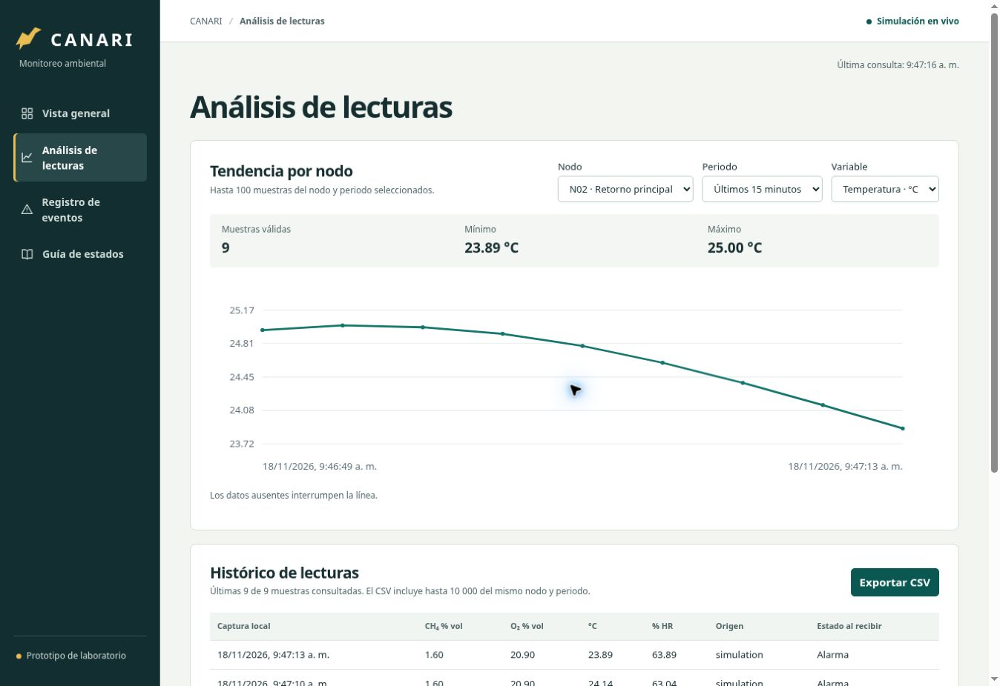
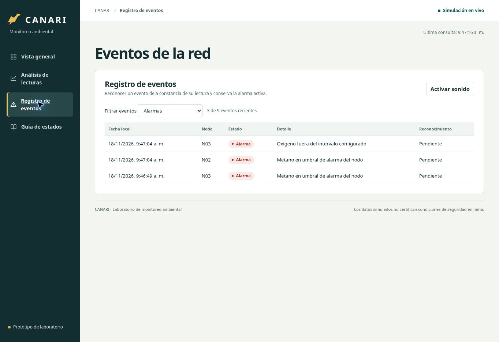

# CANARI · Consola de monitoreo ambiental para minería subterránea


CANARI es un prototipo de laboratorio para estudiar cómo cambian las condiciones ambientales en una mina subterránea. La consola reúne las lecturas de tres nodos simulados. Desde un evento, el operador puede identificar el nodo afectado, consultar sus mediciones y exportar la serie que explica el cambio. Su alcance es la validación de software con datos sintéticos. Las decisiones de seguridad en mina requieren instrumentación y validación en campo.



## Qué puedes explorar

- **Monitoreo ambiental.** Compara metano y oxígeno en porcentaje de volumen, temperatura en °C y humedad relativa en los nodos N01, N02 y N03.
- **Consulta por nodo.** Selecciona un nodo, una variable y un periodo para ver la tendencia, los extremos de la serie y las lecturas registradas.
- **Historial de eventos.** Revisa cambios de estado, alarmas, fallos y muestras vencidas. En una sesión de operador puedes marcar un evento como revisado y conservar su trazabilidad.
- **Reportes CSV.** Descarga hasta 10 000 lecturas del nodo y periodo elegidos. El archivo incluye las cuatro variables para analizarlas fuera de la consola.

## Ejecución local

Necesitas Git, Python 3.10 o posterior con el módulo estándar `sqlite3` y un navegador moderno. La aplicación utiliza la biblioteca estándar de Python y sirve la interfaz desde el mismo proceso.

**1. Clona el repositorio y entra en su directorio.**

```bash
git clone https://github.com/checho13-dev/CANARI.git
cd CANARI
```

**2. Inicia la demostración.** En Windows puedes abrir `VER_DEMO_WINDOWS.bat` o ejecutar en la terminal:

```powershell
py -3 server.py --vista-demo
```

En macOS o Linux:

```bash
python3 server.py --vista-demo
```

**3. Abre la consola.** Visita <http://127.0.0.1:8000>, selecciona **Analizar nodo** y elige una variable. La demo genera lecturas sintéticas cada tres segundos y usa una base temporal. Para terminar, pulsa `Ctrl+C` en la terminal.

Para conservar el historial entre sesiones y reconocer eventos, sustituye `--vista-demo` por `--demo`. En ese modo, copia la clave de operador que imprime la terminal, pégala en el panel y selecciona **Conectar**.

## Stack y arquitectura

| Componente | Implementación | Responsabilidad |
| --- | --- | --- |
| Simulación | Python · `simulator.py` | Genera muestras por nodo y reproduce escenarios normales, alarmas y datos faltantes. |
| Servidor local | Python · `server.py` | Sirve la interfaz web y la API HTTP, controla el acceso y supervisa la antigüedad de las muestras. |
| Lógica y almacenamiento | Python y SQLite · `core.py` | Valida cada muestra, evalúa las reglas y guarda lecturas, estados y eventos. |
| Configuración | `config.json` | Define nodos, ubicaciones y umbrales utilizados por las reglas. |
| Interfaz | HTML, CSS y JavaScript · `web/` | Consulta la API para mostrar el estado de la red, las tendencias y el historial. |

Cuando llega una muestra, la aplicación identifica su nodo y fecha de captura, valida los valores y registra la lectura en SQLite. Si las reglas detectan un cambio de estado, también queda registrado un evento. El panel consulta esos registros y permite exportar las mediciones del intervalo seleccionado.

## Capturas de la consola

| Análisis de lecturas | Registro de eventos |
| --- | --- |
|  |  |

<!-- Para añadir otra captura, guarda la imagen en docs/capturas/ e inserta una línea como esta:

-->

## Pruebas y documentación

Ejecuta las pruebas unitarias y de integración desde la raíz del repositorio:

```bash
python3 -m unittest discover -s tests -v
```

En Windows, sustituye `python3` por `py -3`. Consulta el [manual del programador](anexos/Anexo_A_Manual_programador.md), el [manual de usuario](anexos/Anexo_B_Manual_usuario.md) y las [evidencias de validación](evidencias/) para explorar la API, el uso de la consola y los resultados del ensayo sintético.

## Autoría

Proyecto desarrollado en coautoría por **Sergio Esteban Bello Gómez** ([@checho13-dev](https://github.com/checho13-dev)) y **[@santy19s25e](https://github.com/santy19s25e)**. [Repositorio de origen](https://github.com/santy19s25e/CANARI).
